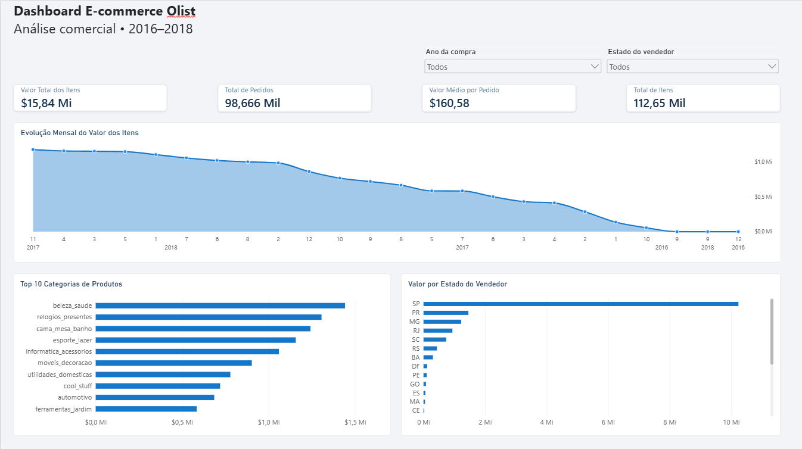
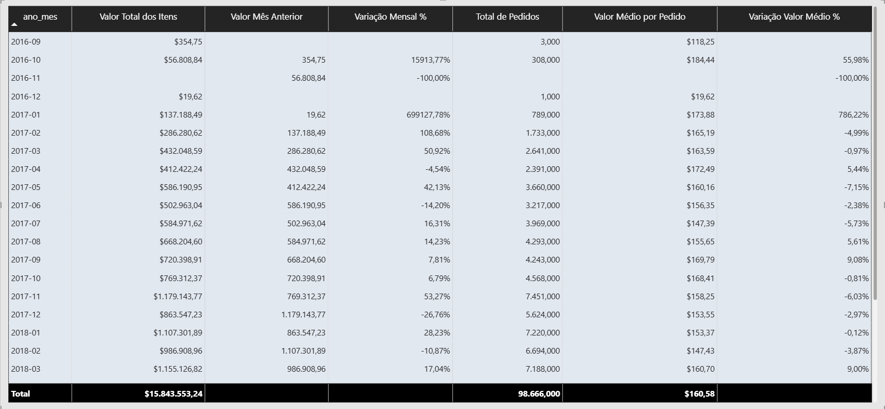

# Análise de Dados E-commerce | Olist

## Sobre o projeto

Projeto de análise de dados desenvolvido com o dataset público de e-commerce brasileiro Olist.

O objetivo é explorar o comportamento comercial, analisar pedidos, produtos, vendedores e construir um dashboard interativo para apoiar a interpretação dos indicadores.

## Tecnologias utilizadas

- Python
- PySpark
- SQL
- Databricks
- Power BI
- DAX

## Etapas do projeto

1. Importação e exploração dos dados.
2. Análise exploratória de dados (EDA).
3. Tratamento e validação dos registros.
4. Modelagem dimensional com tabelas fato e dimensões.
5. Construção de indicadores com DAX.
6. Desenvolvimento de dashboard interativo no Power BI.

## Indicadores principais

| Indicador | Resultado |
|---|---:|
| Valor total dos itens (produtos + frete) | R$ 15.843.553,24 |
| Pedidos distintos com itens | 98.666 |
| Valor médio por pedido | R$ 160,58 |
| Total de itens | 112.650 |

Os valores representam os registros da tabela de itens de pedidos e não necessariamente a receita efetivamente recebida.

## Dashboard

### Visão Geral

### Análise Mensal

## Principais resultados

Em novembro de 2017, comparado a outubro de 2017:

- O valor total dos itens aumentou 53,27%.
- A quantidade de pedidos aumentou aproximadamente 63,11%.
- O valor médio por pedido diminuiu 6,03%.

Esses resultados mostram que o crescimento do valor total foi acompanhado por um aumento no volume de pedidos, apesar da redução do valor médio por pedido.

## Fonte dos dados

Brazilian E-Commerce Public Dataset by Olist, disponibilizado publicamente no Kaggle.

## Observações

O projeto foi desenvolvido para fins educacionais e de portfólio, utilizando dados públicos.